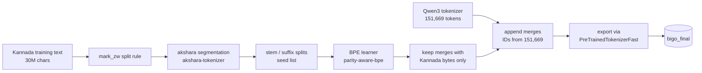

# Big-O Token Tax: a fairer Qwen3 tokenizer for Kannada

**The Big Hack 2.0, Bengaluru · Track 03 (AI research) · Problem R3 "The token tax"**

On Qwen3, the same sentence costs **6.91×** more tokens in Kannada than in English. We extend Qwen3's tokenizer so that Kannada costs **1.08×** English, without changing a single English, JSON, code or tool-call token ID. Arbok, the team's Qwen3-1.7B trained on this tokenizer, uses 27.8 tokens per Kannada sentence instead of 188.9.

| | Qwen3 | Qwen3 + standard BPE extension | **Qwen3 + ours (`bigo_final`)** |
|---|---|---|---|
| Kannada ÷ English tokens (parity) | 6.91× | 2.45× | **1.08×** |
| Tokens per Kannada word | 11.84 | 4.20 | **1.85** |
| Kannada sentences in a 4K window (English: 139) | 17 | 54 | **125** |
| Aksharas cut by a token boundary | 100% | 100% | **0.14%** |
| English / JSON / code / tool-call IDs changed | – | 0 | **0** |

All numbers: FLORES-200 devtest (1,012 sentences); IN22-Gen and Belebele give the same picture.

---

## Contents

1. [The problem](#1-the-problem)
2. [How a byte-level BPE tokenizer works](#2-how-a-byte-level-bpe-tokenizer-works)
3. [Why Kannada is taxed](#3-why-kannada-is-taxed)
4. [Our method](#4-our-method)
5. [What we reused and how the pieces fit](#5-what-we-reused-and-how-the-pieces-fit)
6. [Results](#6-results)
7. [Safety tests](#7-safety-tests)
8. [Failure analysis](#8-failure-analysis)
9. [The model: Arbok](#9-the-model-arbok)
10. [Demo app](#10-demo-app)
11. [Quick start](#11-quick-start)
12. [Reproduce everything](#12-reproduce-everything)
13. [Repository layout](#13-repository-layout)
14. [Data and test hygiene](#14-data-and-test-hygiene)
15. [Limitations](#15-limitations)
16. [Credits and licences](#16-credits-and-licences)

---

## 1. The problem

A language model reads **tokens**, not words. Cost, latency and the context window are all counted in tokens. If a language needs 7 tokens where English needs 1, its speakers pay 7× more per answer, wait longer, and fit 7× less text into the same context.

**R3 asks:** reduce the cost or quality gap for an Indian language, and measure exactly what the improvement costs.

**Hypothesis.** Most of Kannada's token tax in open models comes from *pre-tokenization*, not from vocabulary size. A mark-aware, akshara-safe, suffix-aware extension of Qwen3's BPE cuts the Kannada-to-English token ratio by more than half compared with a standard BPE extension of the same size, and leaves English, JSON, code and tool-call tokens unchanged.

**Result.** Confirmed: at the same 16K new tokens, the split-rule fix alone takes the standard extension from 2.45× to 1.12× (−54%).

---

## 2. How a byte-level BPE tokenizer works

Qwen3 uses byte-level BPE (Byte-Pair Encoding). Encoding a string has three stages:

```
text ──► (1) split rule (regex) ──► chunks ──► (2) UTF-8 bytes ──► (3) apply merges in order ──► token IDs
```

1. **Split rule (pre-tokenizer).** A regular expression cuts text into chunks: roughly words, single digits, punctuation and whitespace. **Merges never cross a chunk boundary.** This stage decides what *can* ever become a token.
2. **Bytes.** Each chunk becomes UTF-8 bytes, mapped to 256 printable symbols. Any text can be encoded; nothing is "unknown".
3. **Merges.** A learned, ordered list of pair merges is applied inside each chunk (`t + h → th`, `th + e → the`, …). Each final piece is one token ID.

**Training BPE:** start from single bytes; repeatedly find the most frequent adjacent pair in the training text and add it as a new merge; stop when the vocabulary is full. Frequent words end up as one token; rare words stay as several pieces.

---

## 3. Why Kannada is taxed

Three effects stack:

| Effect | Detail |
|---|---|
| **3 bytes per character** | Every Kannada code point is 3 UTF-8 bytes, always starting `E0 B2` or `E0 B3`. English letters are 1 byte. |
| **Almost no Kannada vocabulary** | Only **25** of Qwen3's 151,669 tokens contain Kannada, all single characters. Most Kannada characters are byte fragments. |
| **The split rule breaks words** | Qwen3's pattern matches words with `\p{L}+` ("a run of letters"). Kannada vowel signs (ಿ, ೆ, …) and the virama (್) are Unicode **marks** (category `M`), not letters. So every word is cut at every vowel sign *before* any merge runs. |

The third effect is the important one: because merges cannot cross chunk boundaries, **no amount of extra vocabulary can rebuild whole Kannada words** under Qwen3's split rule. That is why a standard BPE extension stalls at 2.45×.

Example: the sentence *"Rain is likely in Bengaluru tomorrow, so take an umbrella"*:

```
ಬೆಂಗಳೂರಿನಲ್ಲಿ ನಾಳೆ ಮಳೆ ಬರುವ ಸಾಧ್ಯತೆ ಇದೆ, ಆದ್ದರಿಂದ ಕೊಡೆ ತೆಗೆದುಕೊಂಡು ಹೋಗಿ.

Qwen3: 104 tokens   (most characters split into raw bytes)
Ours :  15 tokens   ಬೆಂಗಳೂ|ರಿ|ನಲ್ಲಿ| ನಾಳೆ| ಮಳೆ| ಬರುವ| ಸಾಧ್ಯತೆ| ಇದೆ|,| ಆದ್ದ|ರಿಂದ| ಕೊಡೆ| ತೆಗೆದುಕೊಂಡು| ಹೋಗಿ|.
```

**Terms used below**

- **Akshara**: a written Kannada syllable as readers see it. `ಕ್ರಿ` = ಕ + ್ + ರ + ಿ (four code points, one akshara).
- **Virama (್)**: removes a consonant's inherent vowel; used to build conjuncts.
- **ZWNJ / ZWJ** (U+200C / U+200D): invisible joiners; Kannada uses ZWNJ in loanwords such as ಭಜನ್‌.
- **Parity**: Kannada tokens ÷ English tokens for the same sentence. 1.0 = equal cost.
- **Fertility**: tokens per word.

---

## 4. Our method

### 4.1 Append-only extension

We keep **every** Qwen3 token, merge and ID, and append new merges after them.

- New IDs start at **151,669**, the first ID after Qwen3's vocabulary and its 26 special tokens.
- Only merges whose bytes include `E0 B2`/`E0 B3` (Kannada) are added. Those byte pairs appear in no other script, so a new merge can never fire on English, JSON or code. **English identity holds by construction**, and the identity test checks it anyway.
- Final vocabulary: 151,669 + 31,991 = **183,660**.

### 4.2 Layer 1: mark-aware split rule (`mark_zw`)

The one `\p{L}+` in Qwen3's pattern becomes `[\p{L}\p{M}]+`, so marks stay inside words. ZWJ/ZWNJ may continue a word **only right after a Kannada character** (look-behind on U+0C80–U+0CFF), so emoji ZWJ sequences, Persian ZWNJ and Devanagari are tokenized exactly as before.

```diff
  (?i:'s|'t|'re|'ve|'m|'ll|'d)
- |[^\r\n\p{L}\p{N}]?\p{L}+
+ |[^\r\n\p{L}\p{N}]?[\p{L}\p{M}]+(?:(?<=[\x{0C80}-\x{0CFF}])[\x{200C}\x{200D}]+[\p{L}\p{M}]*)*
  |\p{N}| ?[^\s\p{L}\p{N}]+[\r\n]*|\s*[\r\n]+|\s+(?!\S)|\s+
```

`ಮನೆಯಲ್ಲಿ ಇದೆ` ("it is in the house"): Qwen3's rule gives **8** chunks (`ಮನ|ೆ|ಯಲ|್|ಲ|ಿ|ಇದ|ೆ`), ours gives **2** (`ಮನೆಯಲ್ಲಿ|ಇದೆ`).

### 4.3 Layer 2: akshara units

Splitting training text at every akshara would forbid multi-akshara tokens, so instead merges are learned in stages:

| Stage | What it learns | Why |
|---|---|---|
| **a0** | Deterministic merges that build every Kannada character (and space + character) from its bytes | Removes byte fragments |
| **a1** | BPE on aksharas as isolated words until every akshara seen ≥ 5 times is one token | A merge can never stop halfway through a known akshara |
| **b** | BPE over whole-akshara units only; rare aksharas act as barriers | Longer tokens are always built from whole syllables |

Akshara boundaries come from `akshara-tokenizer`, not regex `\X` (grapheme clusters), which splits conjuncts such as `ಕ್ರಿ` incorrectly.

### 4.4 Layer 3: suffix-aware

A hand-written seed list of case endings (`ಯಲ್ಲಿ`, `ಗೆ`, `ಯಿಂದ`, … in `tokenizer/suffix.py`) is applied as a hard stem | suffix split in the training words (stem ≥ 2 aksharas, longest match). Merges therefore don't glue endings onto stems, and one ending token is reused across thousands of words. Sandhi makes the boundary approximate (`ಊರು + ಇನಲ್ಲಿ → ಊರಿ|ನಲ್ಲಿ`).

### 4.5 Layer 4 (parity-aware selection): implemented, not in the final build

`swiss-ai/parity-aware-bpe` can pick, at each step, the merge that helps the worst-compressed language. In a Qwen3 extension only Kannada merges are allowed (Latin merges would change English), so with English held fixed this reduces to standard BPE plus a stopping point at parity. The full build was stopped at 11,700 of 26,770 merges (about 20× slower than plain BPE), so **`bigo_final` = layers 1–3 at 32K new tokens.** We use the package's BPE learner; the gain comes from layers 1–3.

---

## 5. What we reused and how the pieces fit

We did not merge several tokenizers' vocabularies. We kept **one** tokenizer (Qwen3) and used open-source tools to build the new Kannada tokens, then appended them.

| Component | Source | Role |
|---|---|---|
| Qwen3 tokenizer | Qwen3-1.7B (Apache-2.0) | Base vocabulary, merges and IDs, kept unchanged |
| `akshara-tokenizer` | open-source Indic library | Akshara segmentation rules (layer 2) |
| `parity-aware-bpe` | swiss-ai (GitHub) | BPE learner for the new merges, via `tokenizer/bpe_glue.py` |
| Hugging Face `tokenizers` | Hugging Face | Fast runtime and the `tokenizer.json` format |
| Our code (`tokenizer/`) | this repo | Split rule, staged akshara units, suffix splits, Kannada-only merge filter, append + export |



At inference there is a single tokenizer: text → `mark_zw` split rule → bytes → Qwen3's merges followed by our merges → IDs. English text only ever matches Qwen3's merges.

**Two engineering traps, both fixed**

1. HF `tokenizers` renumbers added tokens after `model.vocab` when the vocabulary has an ID gap. The 26 special tokens are now kept in `model.vocab` at their original IDs.
2. In transformers 5, the stock `Qwen2Tokenizer` class rebuilds Qwen's split rule and silently undoes ours. We export with `PreTrainedTokenizerFast` and verify the loaded tokenizer against `tokenizer.json` (`tokenizer/export_hf.py`).

---

## 6. Results

Level 1 = tokenizer only. Parity = Kannada tokens ÷ English tokens for the same sentences.

### 6.1 Against other tokenizers (FLORES-200 devtest)

| Tokenizer | Parity |
|---|---|
| GPT-4 (cl100k) | 8.84× |
| Llama-3 | 8.84× |
| Qwen3 (original) | 6.91× |
| Qwen3 + standard BPE extension (16K) | 2.45× |
| GPT-4o (o200k) | 1.95× |
| Gemma-3 | 1.90× |
| Sarvam-1 | 1.19× |
| **Qwen3 + ours (`bigo_final`, 32K)** | **1.08×** |
| indictok-256k (256K Indic-only vocabulary) | 0.99× |

Only indictok-256k is slightly better, with a separate 256K vocabulary; ours keeps all of Qwen3 and adds 31,991 tokens.

### 6.2 Ablation (16K new tokens each, FLORES)

| Step | Parity | Tokens / word | Aksharas split |
|---|---|---|---|
| Qwen3, no extension | 6.91× | 11.84 | 100% |
| Standard BPE extension | 2.45× | 4.20 | 100% |
| + L1 mark-aware split | 1.12× | 1.91 | 11.3% |
| + L1 with ZW rule | 1.12× | 1.91 | 10.8% |
| + L2 akshara units | 1.14× | 1.96 | 0.14% |
| + L3 suffix splits | 1.19× | 2.05 | 0.14% |

- **Layer 1 does almost all the work**: 2.45× → 1.12× with the same budget (−54%, above the 50% target).
- **Layer 2 costs 0.03×** (+2.5% tokens) and cuts split aksharas from 10.8% to 0.14%. The ZW rule matters once akshara units are on (1.3% → 0.14%).
- **Layer 3 costs 0.05×** (+4.5% tokens); in exchange, case endings stay separate tokens.

### 6.3 Vocabulary sweep

| New tokens | 8K | 16K | 24K | 32K | 64K |
|---|---|---|---|---|---|
| Standard BPE extension | 2.45× | 2.45× | 2.44× (no merges left after 23,790) | – | – |
| Ours (layers 1–3) | 1.43× | 1.19× | – | **1.08×** | 1.01× |

We ship 32K: 0.08× from parity. 64K would double the new embedding rows for a further 0.07×.

### 6.4 Consistency across test sets

| | FLORES devtest (1,012) | IN22-Gen (1,024) | Belebele passages (488) |
|---|---|---|---|
| Qwen3 | 6.91× | 6.83× | 6.93× |
| Standard extension (16K) | 2.45× | 2.41× | 2.46× |
| **Ours** | **1.08×** | **1.14×** | **1.08×** |

### 6.5 Romanized Kannada and Kanglish

| Tokenizer | Kannada script | Romanized (IndicXlit) | Kanglish (181 lines) |
|---|---|---|---|
| Qwen3 | 6.91× | 2.17× | 1.13× |
| Qwen3 + standard ext. | 2.45× | 2.17× | 1.13× |
| **Qwen3 + ours** | **1.08×** | 2.17× | 1.13× |
| GPT-4o (o200k) | 1.95× | 1.97× | 1.03× |
| Gemma-3 | 1.90× | 2.00× | 1.03× |
| Sarvam-1 | 1.19× | 2.36× | 1.25× |
| indictok-256k | 0.99× | 2.05× | 1.15× |

Kannada script is now **half** the cost of the same text romanized; on Qwen3 it was the opposite. Latin text is untouched by design, so romanized and Kanglish are unchanged. Real chat Kanglish is short and full of English words, so it was already cheap.

### 6.6 Context fit

| Window | Qwen3 | Standard ext. | Ours | English |
|---|---|---|---|---|
| 4K tokens | 17 | 54 | **125** | 139 |
| 8K tokens | 36 | 114 | **258** | 286 |
| 32K tokens | 168 | 476 | **1,067** | 1,153 |

FLORES devtest sentences packed in order until the window is full (`results/context_fit.csv`): **7.4× more Kannada** in the same context. For agents, Kannada history and tool descriptions use about a seventh of the context they did.

---

## 7. Safety tests

`pytest tests` runs 10 test functions (58 parametrized cases). All pass on `bigo_final`.

| Test | What it checks | Result |
|---|---|---|
| Identity | 1,400+ English, JSON, code and tool-call strings plus every English test line give the same IDs as Qwen3 | 0 changed |
| Old IDs kept | Every Qwen3 token keeps its string and ID | pass |
| ZW outside Kannada | ZWJ/ZWNJ in emoji, Persian and Devanagari tokenize as before | pass |
| Round trip | `decode(encode(x)) == x` on Kannada, Kanglish, English, mixed text, emoji, numbers, ZWJ/ZWNJ and every test file | pass |
| Akshara integrity | No akshara in our inventory is split in running text | 0 of 155,165 |

**What "akshara-safe" means.** 282 of 155,165 multi-codepoint test aksharas (0.18%) are split, and every one is out of inventory (a rare conjunct or unusual ZWNJ never seen in training). An unseen akshara must be split somewhere, so the test checks the guarantee we can keep: an akshara that is in our inventory is never split. Before the `mark_zw` fix, ZWNJ caused 91% of splits (1.3% → 0.1%).

---

## 8. Failure analysis

FLORES devtest + IN22-Gen Kannada, plus the Kanglish set; each word tokenized with its leading space (`results/failures.md`, `results/failures.csv`).

| Category | Words | Ours no better than Qwen3 | Ours worse than standard ext. | Ours = 1 token |
|---|---|---|---|---|
| All Kannada words | 34,252 | 6 (0.0%) | 84 (0.2%) | 49.5% |
| Rare words (training freq < 5) | 9,652 | 2 (0.0%) | 53 (0.5%) | 1.7% |
| Loanwords ending in virama | 2,331 | 0 | 5 (0.2%) | 30.1% |
| Numbers | 475 | 256 (53.9%) | 0 | 0% |
| English words in Kannada lines | 114 | 101 (88.6%) | 0 | 50.9% |
| Kanglish words | 1,139 | 1,139 (100%) | 0 | 44.3% |

- **Where the standard extension wins:** short rare words. `ಉಭಯಚರಗಳ` (amphibians') is 3 tokens for ours, 1 for the standard extension, 10 for Qwen3. This is the 4.5% cost of layer 3.
- **Numbers and Latin text are unchanged by design.** Mixed-script lines still drop from 16,231 to 2,873 tokens (83 lines) because their Kannada part shrinks.

---

## 9. The model: Arbok

Arbok is **Qwen3-1.7B trained by a teammate on `bigo_final`**. Training is outside this repo; numbers come from the team's benchmark sheet.

| | Arbok (1.7B) | Qwen3 | Navarasa-2.0 (2B) | Gemma-2 (2B) | Krutrim-1 (7B) |
|---|---|---|---|---|---|
| Tokens per Kannada sentence (FLORES+) | **27.8** | 188.9 | 88.3 | 51.6 | 60.7 |
| Time per answer, median | **1.5 s** | 10.0 s | 9.2 s | 2.6 s | 4.3 s |
| English → Kannada chrF++ | 49.6 | 34.1 | 32.0 | 21.3 | 50.1 |
| Kannada → English chrF++ | **57.8** | 54.2 | 20.2 | 45.5 | 57.4 |
| GSM8K Kanglish | 44.8% | 12.4% | 4.0% | 24.4% | 52.8% |
| Team suite, all 275 cases | **90.5%** | 84.4% | 46.9% | 83.6% | 80.4% |

English for the same FLORES+ sentences is 26.7–27.5 tokens, so Arbok's Kannada costs about the same as English. Part of the speed-up comes from shorter answers.

**What it costs:** MMLU 56.2% vs 73.2%, ARC-Challenge 74.9% vs 90.9%, GSM8K (English) 81.8% vs 92.0%, IFEval 64.5% vs 80.8%, MILU Kannada 40.2% vs 47.2%, HellaSwag 70.5% vs 70.8%. English token IDs are identical, so this loss comes from the Kannada training, not from tokenization.

---

## 10. Demo app

`demo/chat/` is a local chat app for Arbok with a small agent harness, plus a metrics page with every result above.

```
cd demo/chat
python server.py          # or double-click run.bat on Windows
# chat:    http://127.0.0.1:8787
# metrics: http://127.0.0.1:8787/metrics
```

- **`server.py`** (standard library only) serves the pages, relays chat to the hosted model's OpenAI-compatible endpoint (the endpoint has no CORS, and the API key stays server-side), and runs the agent's tools. Set `CHAT_BASE_URL`, `CHAT_API_KEY` and `CHAT_MODEL`, or edit the constants at the top.
- **Tools:** `get_weather` (Open-Meteo), `search_wikipedia` (en/kn), `fetch_page`, `calculator` (safe AST evaluation), `get_datetime`, `set_reminder` (stored in the browser).
- **Agent loop:** the endpoint has native tool calling disabled, so tools are described in the system prompt and the model answers with `<tool_call>{"name": …, "arguments": …}</tool_call>`. The page runs the tool, returns `<tool_response>…</tool_response>`, and repeats up to 5 steps. Questions with arithmetic are routed to the calculator first, because the 8B model sometimes guesses sums.
- **Per-answer stats:** tokens, tokens/s and **characters per token**, the token tax made visible.

`demo/harness_test/` has the tool-calling probes and an end-to-end agent test (`e2e_agent.py`).

---

## 11. Quick start

Use the tokenizer from the hand-off zip (`dist/bigo_final_tokenizer.zip`, 2.4 MB) or `artifacts/final/bigo_final`:

```python
from transformers import AutoTokenizer

tok = AutoTokenizer.from_pretrained("artifacts/final/bigo_final")   # loads as PreTrainedTokenizerFast
text = "ಬೆಂಗಳೂರಿನಲ್ಲಿ ನಾಳೆ ಮಳೆ ಬರುವ ಸಾಧ್ಯತೆ ಇದೆ"
ids = tok.encode(text)
print(len(ids), tok.convert_ids_to_tokens(ids))
assert tok.decode(ids) == text
```

Do **not** load it with `Qwen2Tokenizer` / `Qwen2TokenizerFast` directly: in transformers 5 those classes rebuild Qwen's original split rule and undo layer 1.

Check the file: `tokenizer.json` SHA-256 `a1699d6d31550584f3ea1d1faef1e8b3d7ffc7666ffdec18fd8347a58012b4fb`.

To use it with a model, resize the embeddings to 183,660 and train the new rows (`model.resize_token_embeddings(len(tok))`); IDs below 151,669 are Qwen3's and keep their trained embeddings.

---

## 12. Reproduce everything

**Setup (CPU is enough for the tokenizer):**

```
python -m venv .venv && .venv\Scripts\activate          # Windows; use source .venv/bin/activate elsewhere
pip install -r requirements.txt
pip install git+https://github.com/swiss-ai/parity-aware-bpe.git
# akshara-tokenizer: clone it and `pip install .` (see requirements.txt)
huggingface-cli login                                     # FLORES-200 and IN22 are gated
```

**Pipeline** (each step writes its outputs to `data/`, `artifacts/` or `results/`):

```
python -m data.download --only belebele flores in22 kan_Knda kan_Knda_wiki kan_Latn eng_Latn
python -m data.prepare_test && python -m data.clean && python -m data.parity_dev

python -m tokenizer.build_extension --pattern mark_zw --units akshara --suffix seed --new-tokens 32000 \
    --train data/processed/train/kan_Knda_mix.txt --out artifacts/ext/l123z_32k
python -m tokenizer.export_hf --tokenizer artifacts/ext/l123z_32k/tokenizer.json --out artifacts/final/bigo_final

pytest tests                                                  # identity, round trip, akshara safety
python -m eval.level1.matrix && python -m eval.level1.report  # Level 1 matrix, charts, Kanglish tax, failures
python -m eval.level3.context_fit                             # context-window fit

python -m eval.run_all --model <hf-folder> --tag <name>       # model evaluation (GPU)
python -m eval.build_matrix                                   # results/eval_matrix.{csv,md}, SLIDE_NUMBERS.md
python -m tokenizer.package_handoff                           # dist/bigo_final_tokenizer.zip
```

**Romanized test sets** need IndicXlit, which pins an old fairseq and PyTorch < 2.6. Run `notebooks/kaggle_romanize_xlit.ipynb` on Kaggle (a separate Python 3.10 environment); the outputs go to `data/processed/test/*_kan_Latn_xlit.txt`.

**Ablation builds:** vary `--pattern` (`qwen` / `mark` / `mark_zw`), `--units` (`none` / `akshara`), `--suffix` (`none` / `seed`) and `--new-tokens` (8000–64000). Builds land in `artifacts/ext/<name>/` with a `build_report.json`.

---

## 13. Repository layout

```
tokenizer/        build_extension.py   build the append-only extension (all layers)
                  akshara.py           akshara segmentation (wraps akshara-tokenizer)
                  suffix.py            seed list of Kannada case endings (layer 3)
                  bpe_glue.py          runs parity-aware-bpe; maps units to private-use characters
                  extend.py            appends merges/IDs to Qwen3, keeps special tokens in place
                  export_hf.py         exports via PreTrainedTokenizerFast and verifies against tokenizer.json
                  registry.py          baseline tokenizers (cl100k, o200k, Llama-3, Gemma-3, Sarvam-1, …)
data/             download, cleaning, test preparation, parity dev set, IndicXlit romanization, Kanglish set
eval/level1/      token metrics: parity, fertility, bytes, Rényi efficiency, akshara splits; matrix + report
eval/level3/      Belebele, FLORES chrF++, context fit, speed/cost, three-route test
eval/agent/       agent tool-call evaluation
tests/            test_tokenizer.py: identity, old IDs, ZW, round trip, akshara integrity
results/          every number and chart (level1_matrix.csv, kanglish_tax.md, failures.md, charts/, …)
artifacts/final/  bigo_final and the 16K / 32K builds
dist/             bigo_final_tokenizer.zip (hand-off) and Kaggle bundles
demo/chat/        Arbok chat app, agent harness and metrics page
notebooks/        Kaggle jobs (romanization, smoke test, baseline eval)
docs/             PROJECT_PLAN.md, PHASE2_NOTES.md (design facts), EVAL_INSTRUCTIONS.md
```

---

## 14. Data and test hygiene

| Use | Data | Notes |
|---|---|---|
| Kannada training text | Sangraha verified/kan + Kannada Wikipedia, 15M + 15M characters (`kan_Knda_mix.txt`) | Sangraha has ZWNJ stripped (0 per 10K chars vs 33 in FLORES), so Wikipedia was mixed in |
| English reference | 30M characters | Used to keep English safe; no English merges added |
| Test | FLORES-200 devtest (1,012), IN22-Gen (1,024), Belebele passages (488) | Never trained on |
| Romanized test | IndicXlit (beam 4) on all three test sets | 0 failed lines |
| Kanglish test | 181 everyday sentences with English translations | Drafted by Claude, checked by a native speaker on the team |

Kannada text is NFC-normalized the same way in training and test, and ZWJ/ZWNJ are never stripped. No FLORES or Belebele text is in any training data.

---

## 15. Limitations

- **Layer 3 costs about 4.5% more tokens** than layers 1–2. Its benefit (separate case endings) is not separately measured: the Level 2 tiny-model bits-per-character experiment was skipped.
- **Layer 4 (parity-aware selection) is not in the final build** (section 4.5). With only Kannada merges allowed we expect no gain; this is reasoned, not measured.
- **Romanized Kannada and Kanglish are unchanged.** Latin text is left alone to keep English IDs identical. A romanized-merge variant (`--latn-train`, merges checked never to fire on English) is implemented but not built.
- **Numbers and English words inside Kannada text get no gain**; digits stay one token each.
- **Unseen aksharas still split**: 282 of 155,165 in the test sets, all out of inventory.
- **FLORES is formal text.** Everyday chat mixes in English and numbers, so real-world savings will be smaller than 6.91× → 1.08×.
- **The retrained model loses 7–17 points** on English and general-knowledge benchmarks (section 9).
- **Suffixes are a hand-written list.** Morfessor (data-driven morphology) is the planned next step; the method should transfer to Telugu, Tamil, Malayalam and Hindi, which use the same mark categories, but this is not yet measured.

---

## 16. Credits and licences

- **Qwen3** tokenizer and model: Alibaba Qwen team, Apache-2.0.
- **parity-aware-bpe**: swiss-ai. **akshara-tokenizer**: its authors. **Hugging Face** `tokenizers` / `transformers`.
- **Data:** FLORES-200, IN22-Gen and IndicXlit (AI4Bharat), Belebele, Sangraha, Kannada Wikipedia, each under its own licence.
- **Arbok** (model training): a teammate, outside this repo. **Team Big-O.**
